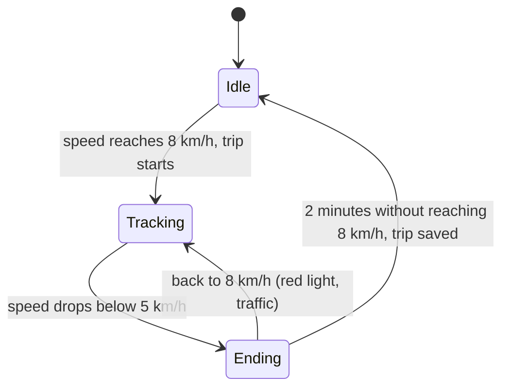

# RoadPulse

An Android app that records your drives on its own, draws each one on a map as a
speed heatmap, and turns your driving stats into a friendly competition with your
friends. Written in Kotlin with Jetpack Compose, backed by Firebase, and mapped
with MapLibre: about 12,000 lines of Kotlin.

**Status:** not released. Built and tested on my own phone; it is not on Google Play.

## Who it is for

- **Drivers who want a record of their driving** without having to remember to
  press start. Keep the phone in your pocket and drive: RoadPulse notices the trip,
  records the route, names it (for example "Plateau → UdeM") and shows your
  distance, time, and average and top speed.
- **Friends who want to compare.** The Board tab ranks you against your friends,
  distance driven earns XP and ranks, and a group drive puts everyone's live
  position on one shared map.

## Why I built it

I built RoadPulse on my own, as an independent project, in about a week
(May 31 to June 5, 2026), for three reasons:

1. **To track my own driving.** I wanted to look back at my routes and speeds
   without starting anything by hand.
2. **To compete with friends.** Driving stats are more fun when they are compared,
   so the app has leaderboards, XP, ranks and group drives.
3. **To ship a real app, not a prototype.** That meant the parts a demo skips:
   email verification, a privacy policy and terms of service, an open-source
   licenses screen, a CSV export of your data, and account deletion that cleans
   up your data in the backend, not just the login.

## How a trip is detected

While auto-tracking is on (it can be switched off in Settings), a foreground
location service reads the phone's GPS every 1 to 3 seconds and feeds each speed
reading to a small state machine:



The two-minute cooldown is what stops a red light from splitting one drive into
two. Trips shorter than a minimum distance (100 m by default, adjustable) are
thrown away, tracking restarts by itself after the phone reboots, and a
persistent notification is always visible while tracking is on.

## Features

**Map**
- Every trip drawn as a speed heatmap in 7 brackets, from 0–30 km/h up to 180+ km/h,
  with a collapsible legend
- Dark or light map style, stat cards, and a button to recenter on your position

**Trips**
- History grouped by date, filtered by all time, this month or this week, with a
  year and month picker
- Trips named automatically from their start and end points; any trip can be renamed
- Trip detail: the route on a map, a speed graph with a scrubber, and a
  segment-by-segment breakdown

**Navigate**
- Search for a place in Canada and get turn-by-turn driving directions

**Social**
- Friends: search, send requests, accept or decline
- Board: a leaderboard of you and your friends, with a podium for the top three
- XP and ranks: 10 XP for every kilometre driven, across five ranks
  (Rookie, Commuter, Cruiser, Racer, Legend)
- Groups and group drives: start a drive and every member's live position appears
  on a shared map
- An in-app notification center for friend requests, accepted requests, group
  invites and group drives starting

**Account and settings**
- Sign up with email and password (verified by email) or sign in with Google
- Speed and distance units, GPS accuracy (high or balanced), minimum trip
  distance, and map style
- Export every trip as a CSV file to Downloads, or delete all recorded trips

## Privacy by design

A driving app knows where you go, so I kept the amount of data that leaves the
phone small:

- **The recorded route stays on the phone.** Every GPS point is stored in a local
  Room database and is never uploaded to Firebase. Only a summary of each trip
  (its name, start and end place names, distance, duration, top and average speed,
  and start time) syncs to Firestore, because that is all the leaderboard needs.
- **Live location is shared only during a group drive**, and only while "Share live
  location" is switched on in Settings.
- **You can hide from friend search.** With profile visibility set to friends only,
  people who are not already your friends cannot find you.
- **Deleting your account cleans up after you in Firestore.** It removes your
  profile and trip summaries, takes you out of your friends' lists, deletes your
  pending friend requests, and handles your groups: groups you own are deleted
  along with their drives and location data, and you leave groups you joined.
  Then the trips on the phone and the Firebase account itself are deleted.
- **No secret keys in the code.** The OpenRouteService key is read from
  `local.properties` at build time, and the Firebase config file is not committed.

Three outside services see some location data. The start and end points of a trip
are sent to OpenStreetMap's Nominatim to look up place names, Navigate sends your
start point and destination to OpenRouteService to get a route, and the map tiles
for the area on screen are loaded from CARTO.

## How it is built

A single-activity Jetpack Compose app using MVVM: each screen has a ViewModel that
exposes its state as a `StateFlow`, and the ViewModels talk to services and a
repository that wrap Room, DataStore and Firestore. Firestore's real-time listeners
are wrapped in `callbackFlow`, so friends, groups, notifications and the
leaderboard update live. Hilt provides the dependencies.

| Area | Tools |
|---|---|
| Language and UI | Kotlin, Jetpack Compose, Material 3, Navigation Compose |
| Architecture | MVVM, Hilt, Kotlin coroutines and Flow |
| On-device data | Room (trips and GPS points), DataStore (settings) |
| Location | Fused Location Provider in a foreground service |
| Maps and places | MapLibre with CARTO basemaps (OpenStreetMap data), OpenRouteService (directions), Nominatim (place names and search) |
| Backend | Firebase Authentication (email and password, Google through Credential Manager), Cloud Firestore |
| Other | OkHttp, Coil |

Runs on Android 8.0 (API 26) and newer; targets API 36.

```
app/src/main/java/com/makan/roadpulse/
├── data/
│   ├── local/         Room database, DAOs and entities, DataStore preferences
│   ├── repository/    Trip repository
│   └── service/       Location tracking, trip detection, Firebase services, routing, geocoding
├── di/                Hilt modules
├── domain/            Models and the repository interface
├── navigation/        Routes and the navigation graph
└── presentation/      One package per screen: map, trips, tripdetail, navigate,
                       leaderboard, profile, friends, groups, auth, notifications
docs/                  Privacy policy and terms of service, served with GitHub Pages
```

## Build it yourself

You need a recent Android Studio and a phone running Android 8.0 or newer.

1. Clone the repository and open it in Android Studio.
2. Create a Firebase project and add an Android app to it with the package name
   `com.makan.roadpulse` and your debug signing key's SHA-1 fingerprint (Google
   sign-in needs it). Turn on Authentication (the Email/Password and Google
   providers) and Cloud Firestore, then download `google-services.json` into `app/`.
3. Put your Firebase project's web client ID in
   `app/src/main/res/values/strings.xml` as `default_web_client_id`, so Google
   sign-in works.
4. Get a free API key from [OpenRouteService](https://openrouteservice.org/) and add
   it to `local.properties` in the project root:
   ```properties
   ORS_API_KEY=your_key_here
   ```
5. Run the app and allow location access "all the time", so trips can be detected
   while the app is in the background.

## Legal pages

- [Privacy policy](https://makanhomayoun.dev/RoadPulse/privacy-policy.html)
- [Terms of service](https://makanhomayoun.dev/RoadPulse/terms-of-service.html)

## Author

Makan Homayoun, Computer Science Technology student at John Abbott College.
Portfolio: [makanhomayoun.dev](https://makanhomayoun.dev) · GitHub: [MakanH](https://github.com/MakanH)
